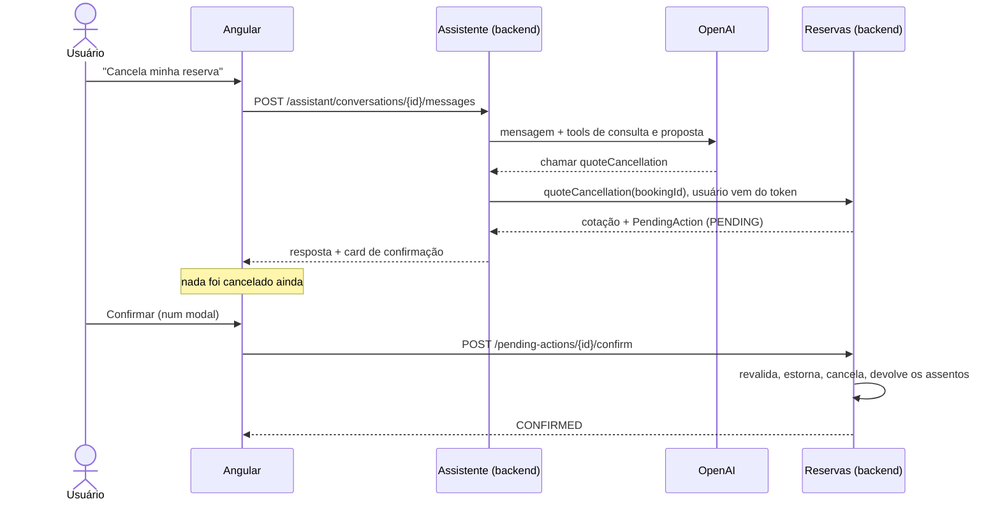
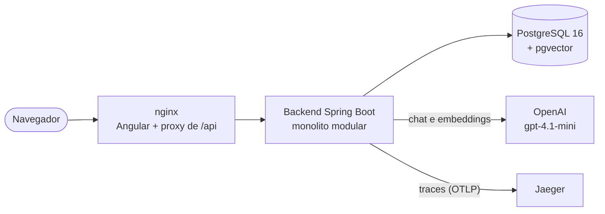
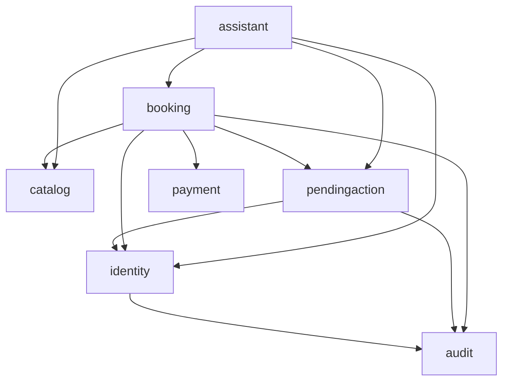

# Atlas Flight Booking Service

[](https://github.com/Phsouzaro/atlas-flight-booking-service/actions/workflows/ci.yml)

Serviço de reservas de voos com um **assistente de IA que conversa em português, mas não mexe em nada
sozinho**. O modelo busca voos, mostra reservas e prepara cancelamentos e remarcações; quem executa é o
usuário, num clique na tela. Projeto de portfólio: catálogo e pagamento são simulados, o interesse está na
arquitetura e em como usar um LLM com segurança.

Backend em **Java 21 + Spring Boot 3.5** (monolito modular com Spring Modulith), front em **Angular 22**,
**PostgreSQL 16 + pgvector**, **Spring AI** com OpenAI. Tudo sobe com Docker Compose.


| Proposta esperando o usuário | Minhas reservas | Celular |
|---|---|---|
|  |  |  |

## O que dá para fazer

- **Conversar com o assistente:** buscar voos ("voos de GRU para o Rio no dia 27"), ver reservas, tirar
  dúvidas de bagagem e tarifa (respondidas a partir dos documentos de política, com RAG), segurar assentos.
- **Reservar:** o hold segura os assentos por 15 minutos; o pagamento (simulado) é feito na tela.
- **Cancelar e remarcar em duas etapas:** primeiro uma cotação, sem efeito nenhum; depois o usuário confirma
  ou rejeita um card na tela. Regras tarifárias por classe, multa, diferença de tarifa e janela de 24h.
- **Desistir de um hold** antes de pagar, liberando os assentos na hora.

## Como a IA é contida

É a decisão central do projeto ([ADR-002](docs/adr/ADR-002-ia-sem-escrita-direta.md)). O modelo só tem
tools de consulta e de **proposta**: não existe tool que pague, cancele ou remarque. Uma proposta vira uma
`PendingAction`, e só um endpoint chamado pela UI, depois de um clique do usuário, executa. Na confirmação o
backend recalcula tudo e recusa se os valores mudaram desde a cotação.



Outras barreiras em volta do modelo ([ADR-005](docs/adr/ADR-005-assistente-loop-memoria-rag.md)):

- **Loop de tools controlado pelo backend:** tool fora da lista é bloqueada antes de executar; no máximo 4
  chamadas ao modelo e 6 tools por turno.
- **Dados pessoais tokenizados:** CPF, passaporte, email e telefone viram `[DOC_1]`, `[EMAIL_1]`... antes de
  ir para o modelo; o valor real só volta dentro do backend, quando uma tool precisa. Número de cartão é
  descartado.
- **O usuário vem do token**, nunca de um parâmetro que o modelo escolhe.
- **Evals:** no CI, um servidor que imita a API da OpenAI roda o Spring AI, as tools e o banco reais e
  verifica que nada destrutivo acontece sem confirmação e que injection não executa nada. Contra o modelo
  real, um conjunto de casos opcional (`-Dllm.evals=true`).

## Arquitetura



O backend é um monolito modular ([ADR-001](docs/adr/ADR-001-monolito-modular.md)): cada módulo só expõe o
pacote raiz, o `internal` é privado, e o Spring Modulith quebra o build se alguém atravessar uma fronteira ou
criar ciclo. Dependências entre os módulos, como o Modulith as extrai do código:



(Todos usam `shared`, o módulo aberto com relógio, dinheiro, idempotência, rate limit e observabilidade.)

| Módulo | Responsabilidade |
|---|---|
| `identity` | Cadastro, login, JWT, sessão com refresh token |
| `catalog` | Aeroportos, voos, tarifas, inventário de assentos |
| `booking` | Hold, pagamento, cancelamento, remarcação, expiração |
| `pendingaction` | Propostas que só executam com confirmação do usuário |
| `payment` | Gateway de pagamento (implementação simulada) |
| `audit` | Trilha de auditoria de toda escrita de negócio |
| `assistant` | Chat, tools, memória, RAG de políticas, PII |
| `shared` | Clock, Money, Idempotency-Key, rate limit, observabilidade |

O `pendingaction` executa as ações sem conhecer o `booking`: cada módulo registra um handler pelo tipo da
ação. Assim não há ciclo entre "booking propõe" e "pendingaction executa no booking".

## Decisões (ADRs)

| ADR | Decisão |
|---|---|
| [001](docs/adr/ADR-001-monolito-modular.md) | Monolito modular em vez de microsserviços |
| [002](docs/adr/ADR-002-ia-sem-escrita-direta.md) | A IA não tem permissão de escrita direta |
| [003](docs/adr/ADR-003-spring-modulith-e-flyway.md) | Spring Modulith para fronteiras, Flyway dono do schema |
| [004](docs/adr/ADR-004-concorrencia-de-assentos.md) | Update condicional para a disputa pelo último assento |
| [005](docs/adr/ADR-005-assistente-loop-memoria-rag.md) | Loop de tools próprio, memória em Postgres, RAG como tool, PII tokenizada |
| [006](docs/adr/ADR-006-rate-limit.md) | Rate limit em memória por rota e por conta |
| [007](docs/adr/ADR-007-sessao-refresh-token.md) | Access token curto e refresh token rotacionado em cookie |

## Rodando

Precisa de Docker. Para desenvolver, também de JDK 21 e Node 24.

Crie um `.env` na raiz (ele fica fora do git):

```bash
POSTGRES_PASSWORD=troque-por-uma-senha
JWT_SECRET=troque-por-um-segredo-aleatorio-com-32-caracteres-ou-mais   # ex.: openssl rand -base64 48
OPENAI_API_KEY=sk-...                                                  # opcional: só o chat precisa
```

```bash
docker compose up --build
```

| Endereço | O quê |
|---|---|
| http://localhost:4200 | Aplicação (crie uma conta na tela de login) |
| http://localhost:8080/swagger-ui.html | API (faça login em `/auth/login` e use o Authorize) |
| http://localhost:16686 | Jaeger: traces de cada request, inclusive as chamadas ao modelo |

Sem `OPENAI_API_KEY` tudo funciona, menos o chat, que responde que o assistente está indisponível. O perfil
`local` (padrão no Compose) popula 12 aeroportos e voos para os próximos 60 dias.

Desenvolvimento:

```bash
cd backend && ./mvnw verify            # testes do backend (Testcontainers, precisa do Docker)
cd frontend && npm install && npm start # front em :4200 com proxy para o backend em :8080
cd frontend && npm run test:ci          # testes do front
```

Eval contra o modelo real (custa centavos): `OPENAI_API_KEY=... ./mvnw test -Dtest=AssistantLiveEvalTest -Dllm.evals=true`.

## Qualidade

- **Testes:** 115 no backend (um deles, o eval contra o modelo real, é opcional), com integração contra
  PostgreSQL real via Testcontainers (sem H2), e 27 no front
  (Vitest). Os testes de concorrência, revalidação, PII e detecção de roubo de sessão foram validados
  quebrando o código de propósito e vendo o teste falhar.
- **Concorrência:** a disputa pelo último assento é testada com requisições simultâneas de verdade
  ([ADR-004](docs/adr/ADR-004-concorrencia-de-assentos.md)).
- **Idempotência:** todo POST que muda estado aceita `Idempotency-Key`; repetir não cobra nem reserva duas vezes.
- **Segurança:** rate limit no login, no cadastro e no chat; access token de 15 min só em memória; refresh
  token em cookie HttpOnly com rotação e detecção de reuso; CSP e headers no nginx; erros em
  `application/problem+json` (RFC 9457).
- **Observabilidade:** o trace id é o correlation id (header `X-Trace-Id`, campo `traceId` nos erros, em cada
  linha de log JSON); métricas Prometheus de negócio, do assistente e de rate limit; traces no Jaeger.


- **CI:** GitHub Actions roda os testes do backend (gerando os diagramas do Modulith como artefato) e os
  testes e o build de produção do front.

## Estrutura

```
backend/                Spring Boot (Java 21), módulos em src/main/java/com/atlas/<módulo>
  src/main/resources/db/migration/   migrations Flyway (V1 a V14)
  src/main/resources/assistant/      system prompt versionado e documentos de política do RAG
frontend/               Angular 22 (ver frontend/README.md)
  nginx/                configuração do container: proxy, cache, CSP
  scripts/              contrato da API e capturas de tela deste README
docs/adr/               decisões de arquitetura
docs/phase-0-guide.md   como a fundação funciona e como criar um módulo novo
docker-compose.yml      Postgres, backend, front e Jaeger
```

## Limitações conhecidas

- Catálogo e pagamento são simulados (cartões de teste na tela; `tok_decline` recusa).
- Rate limit em memória: vale para uma instância; com réplicas, precisaria de Postgres ou Redis.
- Revogar uma sessão não derruba o access token já emitido: ele vale até vencer (no máximo 15 minutos).
- Cobrança e estorno acontecem dentro da transação; com um gateway real seria preciso outbox ou compensação.
- O assistente responde só em português e sem streaming.
- As capturas de tela são geradas por `npm run screenshots` (na pasta `frontend`) com o app rodando.
